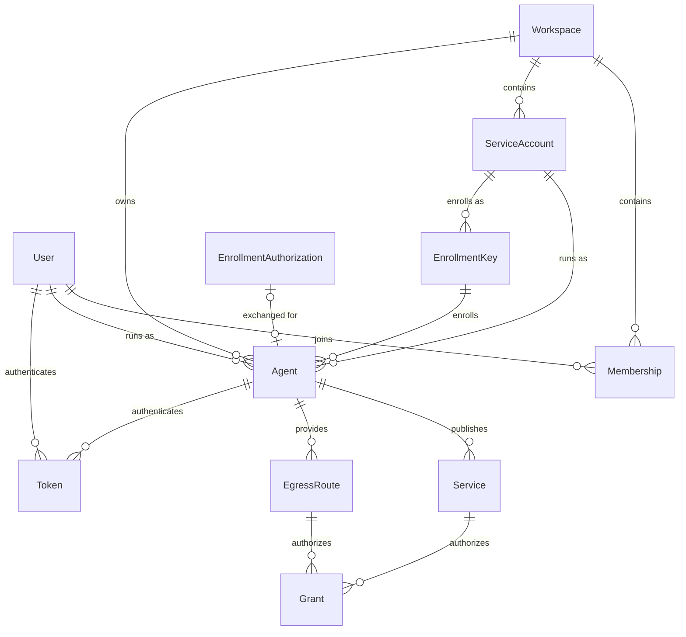
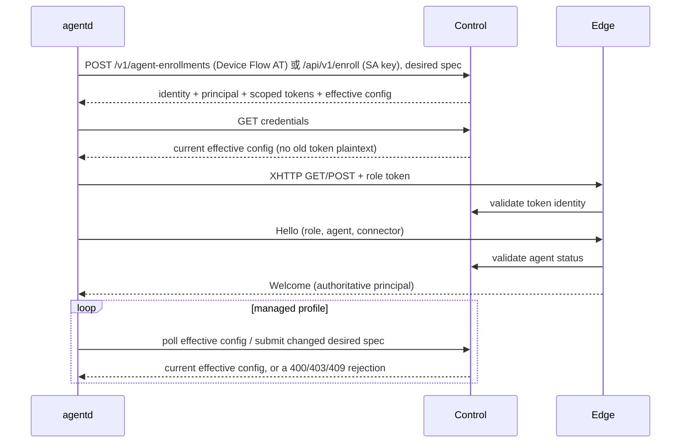

# 当前后端实现与状态边界

本文件描述独立 agents 仓库中的实现。Control、Edge、Console 可分别运行；持久状态与连接目录仍分别由一个 Control 和一个 Edge 拥有。`agents serve` 保留单进程开发模式。长期设计见 agentd 仓库的 `docs/agents-agentd-architecture.md`。

实体、状态机、级联与版本号的权威说明见 [实体、状态机与关系](model.md)，本文件只描述组件职责、路由和接口。

2026-10-18 起，接入和配置变更已改为权限/策略自动校验，`Approval`、`pendingApproval`、`/approval` 和 `autoApprove` 均已删除（DB v3 迁移）。2026-10-19 起 Agent 属于 Workspace、运行主体恰为一个 User 或 Service Account，个人设备经 Hydra Device Flow（`agentd login`）注册（DB v4），设计见 [身份与 Device Flow 设计](identity-and-device-flow.md)。

## 对照 Headscale 的职责分层

| Headscale 参考 | 本项目 | 责任 |
|---|---|---|
| `cmd/headscale` | `cmd/agents` | 配置、状态目录锁、监听与优雅退出 |
| `hscontrol` 应用入口 | `control/app.go`、`handlers.go` | 组装控制面、Edge、Console；HTTP 路由与错误映射 |
| `hscontrol/types` | `control/types` | 持久实体、身份与路由决策 |
| `hscontrol/db` | `control/db` | SQLite/PostgreSQL、显式迁移、外键、事务和 revision CAS |
| `hscontrol/state` | `control/state` | 唯一变更入口、配置自动校验、决策与通知；每个变更调用 `control/authz` |
| `hscontrol/policy` | `control/authz` | 授权模型：控制面 RBAC 矩阵与数据面 Grant 规则，见 [授权模型](authorization.md) |
| 独立数据面适配 | `edge` | XHTTP 会话绑定、连接目录、业务流转发与撤权 |

这里参考的是结构和状态管理责任，不复用 WireGuard、DERP、Tailscale 节点协议。客户端仍按 cloudflared 的 `config / connection / orchestration / supervisor` 分层。

`State` 在单写者锁内生成独立快照，完成校验与 SQL 事务后发布新 revision，再通知 Edge。提交期间读请求继续使用上一份已提交快照，不被写入阻塞。失败事务不会发布内存状态；同一配置重传不产生新审计或新 revision。读接口返回脱离内部对象的视图。SQL 只写入与上一快照不同的行，审计只追加；仍面向单控制进程，PostgreSQL 并不自动提供多控制节点同步。

## 当前实体关系

- User 是实例身份；Membership 是该 User 在某个 Workspace 内的 `owner / maintainer / developer / guest` 角色。
- Service Account 是 Workspace 内的机器主体，不登录 Console；由 maintainer/owner 或 instance admin 管理，撤销为终态。
- Agent 是持久设备 profile，属于一个 Workspace，主体恰为一个 User 或同 Workspace 的 Service Account，`CreatedBy` 只记录注册操作人。`Roles` 是角色上限（User 设备随 Membership，SA 设备由注册确定）；`Desired` 是 agentd 上报的服务端相关配置（不含本地路径、监听和 ingress routes）；`Effective` 是 Control 按 `Desired ∩ 角色上限 ∩ Workspace 内置策略` 自动计算的生效配置。
- EnrollmentKey 是无人值守注册凭据，绑定一个 Service Account，有角色上限、次数、到期和撤销状态；迁移保留的旧 User 密钥只兼容到期。EnrollmentAuthorization 是一次 `agentd login` 的确认与一次性兑换记录。两者都只用于首次注册，不是业务会话凭据。
- Service 固定绑定一个 Agent 和服务名称；源站 URL 由该 Agent 的配置声明。访问主机名为 `<service>.<workspace>.<instance-host>`。
- EgressRoute 将一个域名/端口/TLS 规则固定绑定到一个 Agent，并有优先级。它不授予用户访问权。
- Grant 是数据面授权：将 Service 或 EgressRoute 授权给 User、Workspace 的人类成员，将 EgressRoute 授权给同 Workspace 的 Service Account，或仅对 Service 授权给所有已登录用户（`authenticated`）或匿名访问者。多条有效 Grant 是并集；撤销其中一条不撤销其他有效授权。管理操作的权限（控制面 RBAC）与 Grant 互相独立，两者见 [授权模型](authorization.md)。
- Token 分为 `user / enrollment / control / access / provider`，用途不可替代。原文仅在创建或注册时交付，SQL 保存哈希。
- 连接目录与 Flow 是进程运行态，不是数据库中 Agent 的在线字段。进程重启后凭据和策略保留，在线连接由 agentd 重连重建。

图中的 EnrollmentKey → Agent 表示注册过程中的关系；Agent 不保留注册密钥的外键。

Service 和 EgressRoute 是内部持久实体。管理 API 将它们投影成安全的 ServerView 和 RouteView；角色集合 ingresses、egresses 是同一 Agent 的不同能力视图，servers 则可以包含一个 Agent 提供的多个服务。Grant 授予的是业务访问权，不会单独让 Workspace 出现在用户的管理列表中；管理可见性仍取决于 Membership 与实例管理员身份。

新 Service 首次发布时创建一条本 Workspace 成员 Grant，默认 7 天（Control 配置 `serviceGrantTTL`，最长 720h）；之后不会自动补建或延长。Egress 不自动生成 Grant。

## 注册与连接状态

Agent 只有 `active / revoked` 两个状态，详细状态机与级联见 [model.md](model.md)。注册和配置更新都由 Control 自动校验：通过即生效，越权 403、非法 400、名称冲突 409，被拒的更新记录在 `lastRejection`，上一份生效配置继续运行。

HTTP 承载身份和 Hello 必须使用同一个 TokenID；不能在外层认证为 A、内层声明为 B。Hello 不携带 revision 或服务声明（协议 v3）：每条流都由 Control 的当前决策和 agentd 本地配置按内容授权，因此生效配置变化不需要重建 provider。一个进程的 ConnectorID 在断线重连期间保持不变；同一个 Agent 不接受另一个 Connector 并行抢占。新会话握手完成后才替换同一 Connector 的旧会话，旧连接的退出清理带条件检查，不能删除新连接。

agentd 以指数退避与抖动重连。控制面 401 立即结束运行并提示重新注册（`login --replace` 或 `enroll --replace`）；Control 不可达时继续使用已同步的生效配置直到其 24 小时有效期结束。正常控制轮询为 2 秒；原文凭据不在每次刷新时重新下发。生效配置变化立即保存，仅有效期滚动时最多每分钟保存一次。

本地 reload 立即应用 serve、egress 和 ingress routes 的收紧，取消受影响的 opening/active Flow，不关闭共享 provider 上的其他业务；扩展在 Control 接受后生效。身份、监听器和承载配置变化需重启，但不会阻止同一次 reload 中的收紧生效。

设备控制凭据有效且距到期不足 7 天时，相关未撤销凭据续至 30 天；TokenID 和哈希保持不变，不会打断会话。用户可更新自己的 Token，管理员也可更新用户 Token；旧 Bearer 立即失效，已兑换的浏览器会话保留原到期。凭据被撤销或过期后用 `agentd login --replace` 或 `enroll --replace` 重新注册：只有 Control 确认旧凭据已失效时才替换。同一主体可立即回收原名称，其他主体需等待 7 天墓碑期；回收会清除旧记录，不继承其授权和路由。

## Serve 与 Egress 路由

Serve 路径：

1. 控制域和服务域隔离。服务浏览器会话通过中央登录、一次性 code、host-only state 与 service Cookie 建立；每次请求仍检查资源 Grant。
2. 按规范化 Host 精确找到 Service，确认 User/匿名授权、Agent 状态，以及服务在其生效配置中。
3. 在连接目录中找到该 Agent 当前的 provider 会话。
4. 为这一 HTTP 请求创建独立 provider Flow。provider 再次核对本地服务名和 origin 与生效配置一致，然后请求本地 HTTP 服务。
5. 平台 Bearer、平台 Cookie、伪造身份头不会到达源站。源站不能设置平台 Cookie 或覆盖其他域的 Cookie。业务认证头和 host-only 应用 Cookie 保留。

Egress 路径：

1. ingress 本地规则先过滤 HTTP CONNECT / SOCKS 请求；不匹配直接拒绝。
2. Edge 以 access 会话的真实 User/Workspace 检查候选目标，随后有界读取 TLS ClientHello，核对规范化域名和 SNI。
3. 路由按较小 priority、exact 优先、较长 suffix 优先选择；只检查选中规则的授权，不因被拒、出口离线或拨号失败回落到更宽规则。
4. 精确选中该规则指定的 Agent 打开 Egress Flow；重放原始 ClientHello，再转发原始字节。
5. provider 校验自身本地 allow/deny 与生效 allow/deny 的交集，并检查目标地址；目标站点 TLS 不被 Edge 解密。

两条路径的 Flow 都绑定资源 ID、Agent、主体和目标，不会在续租时切换出口；生效配置 revision 只作记录，无关变化不会关闭流。短租约续期、硬上限、CANCEL 和故障关闭规则见 [Edge 协议说明](../edge/README.md)。浏览器身份到期会取消对应 HTTP 请求，即使资源 Grant 的到期更晚。

## 主要接口

管理 REST API 位于 `/v1`，完整请求和响应见 [OpenAPI](../api/openapi.json)。管理员的全局资源位于 `/v1/admin/`，普通用户从 `/v1/workspaces` 选择工作空间后使用 `/v1/workspaces/{workspaceId}/...` 子资源。所有管理员路由先验证实例管理员身份；普通列表和详情按 [授权模型](authorization.md) 的“可见即可管理”规则裁剪，与写操作使用同一套 `control/authz` 判断，筛选参数只缩小可见范围。不可见的资源详情返回 404。`GET /v1/workspaces/{workspaceId}/permissions` 返回调用者在该工作空间的角色与权限列表，Console 据此显示操作。

| 资源路径 | 方法与用途 |
|---|---|
| `/v1/instance`、`/v1/instance/status` | GET 公开入口信息、认证后的 revision/Edge 可用性；不返回实体快照 |
| `/v1/sessions`、`/v1/sessions/current` | POST 创建 Cookie 会话（201）；GET 当前 Cookie 会话；DELETE 退出（204） |
| `/v1/users/me`、`/v1/users/me/tokens` | GET 当前用户；POST 替换自己的用户 Token（201，一次性返回新秘密） |
| `/v1/admin/users`、`/v1/admin/workspaces`、`/v1/admin/agents` | GET 分页列表与 `/{id}` 详情；用户创建仅在 admin 命名空间，POST 返回 201 |
| `/v1/workspaces` | GET 当前用户可见的 Workspace；POST 创建 Workspace（201），任何有效用户均可，创建者成为 owner，实例管理员以外的用户最多拥有 20 个且不能使用 `personal-` 前缀 |
| `/v1/admin/users/{id}`、`/v1/admin/users/{id}/tokens` | PATCH `{disabled:true}` 停用；POST 替换指定用户 Token |
| `/v1/workspaces/{workspaceId}/users` | GET 当前空间可见成员的安全用户资料；非管理员没有实例全局用户目录 |
| Workspace 的 `/agents`、`/ingresses`、`/servers`、`/egresses`、`/routes` | GET 设备、访问端角色、发布服务、出口提供方角色和路由的独立分页视图；有对应详情接口 |
| Workspace 的 `/agents/{agentId}` | PATCH `{status:"revoked"}` 撤销；不存在批准接口 |
| Workspace 的 `/servers/{serviceId}`、`/routes/{routeId}` | PATCH `{enabled:boolean}` 更新启用状态；POST `/routes` 仅创建 `kind:"egress"` 的出口路由，服务路由由设备配置产生 |
| Workspace 的 `/memberships`、`/memberships/{userId}` | GET 列表/详情；PUT `{role}` 幂等设置成员（200）；DELETE 移除（204） |
| Workspace 的 `/service-accounts`、`/service-accounts/{serviceAccountId}` | maintainer+ 的 GET 列表/详情、POST 创建（201）；PATCH `{description}` 或 `{status:"revoked"}`（终态）；其他成员看不到 SA |
| Workspace 的 `/service-accounts/{serviceAccountId}/enrollment-keys` | POST 为该 SA 创建无人值守注册密钥（201，一次性返回秘密，Location 指向 `/enrollment-keys/{keyId}`）；不接收 User |
| Workspace 的 `/enrollment-keys`、`/grants` | GET 列表与详情；PATCH 单项 `{revoked:true}` 撤销，不能恢复；POST `/grants` 创建（201；`service_account` 仅出口，`authenticated` 与 `anonymous` 仅服务） |
| Workspace 的 `/permissions` | GET 调用者在该工作空间的 `{role, admin, permissions}` |
| `/v1/device-authorizations/{id}`、`/confirm`、`/reject` | Console 的 `agentd login` 确认页：读取可选项、提交 Workspace 与主体或拒绝；仅限发起该授权的浏览器中经 SSO 的本人 Cookie 会话 |
| `/v1/agent-enrollments` | POST 以 Device Flow access token（Bearer）一次性兑换新 Agent（201）；已兑换返回 409 |
| Workspace 的 `/connections`、`/flows` | GET 可见在线连接和流；Edge 不可用返回 503，不能将其误认为空列表 |
| `/v1/admin/audit-events` | GET 仅管理员可见的分页审计记录和详情 |

管理员还具有全局 `ingresses`、`servers`、`egresses`、`routes`、`memberships`、`service-accounts`、`enrollment-keys`、`grants`、`connections`、`flows` 列表和相应资源操作；每个端点的参数以 OpenAPI 为准。Workspace 子路径的创建请求不接收 `workspaceId`，资源归属由 URL 决定；admin 创建请求显式携带它。PATCH 使用独立输入结构，只接受声明的字段，不开放通用实体修改。

Agent 是设备身份，可以同时承担 ingress 和 egress 角色，也可以提供多个 server。角色视图仅嵌入 `AgentSummary {id,name,status,roles}` 与 `effectiveRevision`，不泄露完整 Desired、生效配置或源站地址。Route 明确包含 `kind:serve|egress` 和 `targetType:server|egress`；服务路由引用 Service，出口路由引用指定 Agent，路由 ID 与设备 ID 不能混用。完整配置只由授权的 Agent 详情返回。

集合统一返回 `{items:[],pagination:{page,pageSize,total,totalPages}}`。`page` 默认 1，`pageSize` 默认 20、最大 100；越界页返回空数组。服务端先授权，再筛选和排序，最后统计及分页。`sortBy` 仅接受资源支持的字段，`sortOrder` 为 `asc|desc`，并使用稳定 ID 处理相同排序值。可用筛选包括名称 `q`、Workspace、用户、状态、启用/撤销状态、资源引用等，详见每个集合的 OpenAPI 参数。无效或未知查询参数返回 400。列表是实时读取，不保证多个请求构成同一事务快照。

旧聚合 `/api/v1/state` 和旧管理动作路径已删除，不再返回 SPA HTML。Console 基于 shadcn/ui，页面地址即路由：`/workspaces/{workspaceId}/{overview|members|agents|ingresses|egresses|servers|routes|access}`，实例管理员页面在 `/admin/{workspaces|users|agents|ingresses|egresses|servers|audit}`，`agentd login` 的确认页在 `/device/{id}`。Console 按当前页面、工作空间和页码调用资源 API，表单候选独立搜索和分页；身份或 Workspace 改变会取消旧请求。管理资源支持 User Bearer 或 Cookie；浏览器 Cookie 写请求同时要求同源 Origin 和内存 CSRF Token。`/v1/sessions/current` 仅表示实际 Cookie 会话，Bearer 身份应读取 `/v1/users/me`。错误保持 `{error:{kind,message}}`：未认证 401、已认证但权限/CSRF 被拒 403、不可见资源 404、状态冲突 409、超大 JSON 413、媒体类型不支持 415、依赖不可用 503。

设备控制协议使用 `POST /api/v1/enroll`（SA 注册密钥）、`POST /v1/agent-enrollments`（`agentd login`）、`GET /api/v1/agent/credentials`、`POST /api/v1/agent/config`。取消审批后请求体只包含身份与 desired spec，凭据文档为 v2，承载协议为 v3；agentd 需与服务端同时升级。`/agent` 是独立 XHTTP 入口，传输版本为 2：上行沿用 Xray-core packet-up 的合并写入与并发 POST。Edge 同时接受版本 1 的 agentd，因此先发布 Edge 再升级 agentd；版本 2 的 agentd 连接旧 Edge 会在 GET 阶段被拒绝。`/auth/oidc/login`、`/auth/oidc/callback`、`/auth/authorize`、Hydra 使用的 `/oauth/device`、`/oauth/login`、`/oauth/consent`、`/oauth/device/done`、`/oauth/error` 和服务域 `/__agents/callback` 是浏览器导航协议，内部 Control/Edge RPC 也不在本次迁移范围。

## 已验证与未实现

测试覆盖真实 SQLite/HTTP Control/Edge/Supervisor、CONNECT 与 SOCKS、目标 TLS 原样传递、撤销活跃流、自动校验与拒绝、生效配置变化不重连、v2→v3 迁移、名称回收、重连、租户隔离、Cookie/CSRF/平台令牌边界。PostgreSQL 独立 CI 使用真实数据库验证迁移、重开、事务冲突与外键回滚。浏览器验收包括创建注册密钥、CLI 注册、设备上线及服务 SSO。

OIDC 已支持 discovery、授权码 + PKCE、state/nonce、ID token 验证和 issuer/subject 绑定，并通过 v1→v2 显式迁移持久化身份关联；v2→v3 迁移移除审批模型，v3→v4 迁移引入 Service Account 与 typed principal，v4→v5 迁移加入 `authenticated` 授权主体。当前仍没有 TUN、WSS、多 Edge 路由/迁移、自动秘密轮换或真实 CDN 兼容性验收。SQL 已按行增量写入，但 Control 仍在内存中保存完整快照并只支持单控制进程。生产部署必须为控制域、承载域与服务域准备 DNS 和正确的证书：`*.agents.example.com` 不覆盖 `hello.demo.agents.example.com`，需要覆盖相应 Workspace 服务层级。
