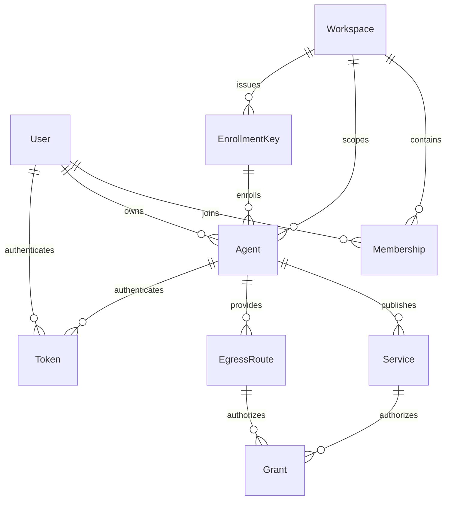
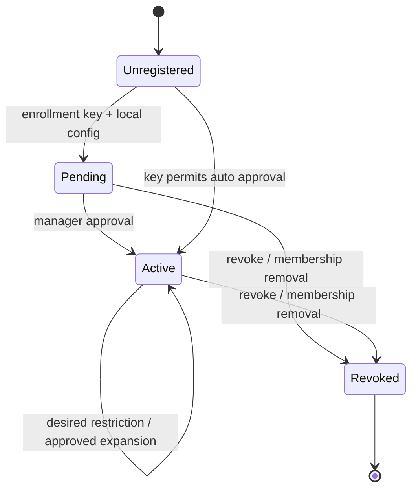
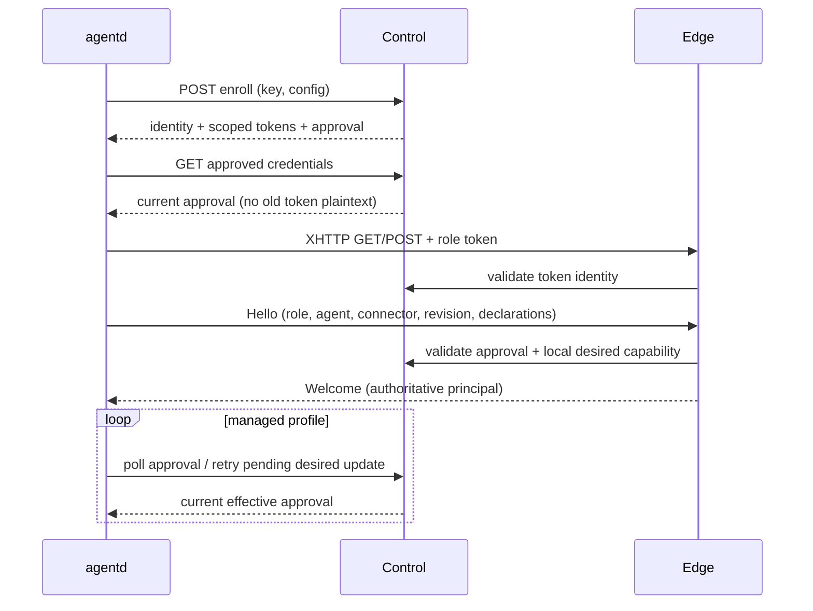

# 当前后端实现与状态边界

本文件描述独立 agents 仓库中的实现。Control、Edge、Console 可分别运行；持久状态与连接目录仍分别由一个 Control 和一个 Edge 拥有。`agents serve` 保留单进程开发模式。长期设计见 agentd 仓库的 `docs/agents-agentd-architecture.md`。

## 对照 Headscale 的职责分层

| Headscale 参考 | 本项目 | 责任 |
|---|---|---|
| `cmd/headscale` | `cmd/agents` | 配置、状态目录锁、监听与优雅退出 |
| `hscontrol` 应用入口 | `control/app.go`、`handlers.go` | 组装控制面、Edge、Console；HTTP 路由与错误映射 |
| `hscontrol/types` | `control/types` | 持久实体、身份与路由决策 |
| `hscontrol/db` | `control/db` | SQLite/PostgreSQL、显式迁移、外键、事务和 revision CAS |
| `hscontrol/state` | `control/state` | 唯一变更入口、RBAC、批准、决策与通知 |
| 独立数据面适配 | `edge` | XHTTP 会话绑定、连接目录、业务流转发与撤权 |

这里参考的是结构和状态管理责任，不复用 WireGuard、DERP、Tailscale 节点协议。客户端仍按 cloudflared 的 `config / connection / orchestration / supervisor` 分层。

`State` 在锁内生成独立快照，完成校验与 SQL 事务后发布新 revision，再通知 Edge。失败事务不会发布内存状态；同一配置重传不产生新审计或重新进入待批准。读接口返回脱离内部对象的视图。当前写入是完整事务快照，面向单控制进程；PostgreSQL 并不自动提供多控制节点同步。

## 实体关系

- User 是实例身份；Membership 是该 User 在某个 Workspace 内的 `owner / maintainer / developer / guest` 角色。
- Agent 是持久设备 profile，绑定 User 和 Workspace。`Roles` 是注册密钥允许申请的角色；`Desired` 是本地意图；`Approval` 是已批准能力。实际能力取两者交集。
- EnrollmentKey 有角色上限、次数、到期和撤销状态。它只用于首次注册，不是业务会话凭据。是否自动批准由有权管理的创建者决定。
- Service 固定绑定一个 Agent 和服务名称；源站 URL 由该 Agent 的配置声明。访问主机名为 `<service>.<workspace>.<instance-host>`。
- EgressRoute 将一个域名/端口/TLS 规则固定绑定到一个 Agent，并有优先级。它不授予用户访问权。
- Grant 将 Service 或 EgressRoute 授权给 User、Workspace 成员，或仅对 Service 授权给匿名访问者。多条有效 Grant 是并集；撤销其中一条不撤销其他有效授权。
- Token 分为 `user / enrollment / control / access / provider`，用途不可替代。原文仅在创建或注册时交付，SQL 保存哈希。
- 连接目录与 Flow 是进程运行态，不是数据库中 Agent 的在线字段。进程重启后凭据和策略保留，在线连接由 agentd 重连重建。

图中的 EnrollmentKey → Agent 表示注册过程中的关系；Agent 不保留注册密钥的外键。

默认新 Service 创建一次、有效 24 小时的本 Workspace 成员 Grant；Egress 不自动生成 Grant。重新批准不会恢复已撤销的默认授权。

## 注册与连接状态

数据库中的状态是 `pending / active / revoked`；扩权申请使用单独的 `pendingApproval` 标志。Active Agent 申请新能力期间仍可提供已批准且本地保留的旧能力。Pending 设备可以使用其获准注册的 ingress 角色，但还不能成为 provider。

HTTP 承载身份和 Hello 必须使用同一个 TokenID；不能在外层认证为 A、内层声明为 B。provider 的 revision 必须等于当前批准。一个进程的 ConnectorID 在断线重连期间保持不变；同一个 Agent 不接受另一个 Connector 并行抢占。旧连接的退出清理带条件检查，不能删除新连接。

agentd 以指数退避与抖动重连。控制面 401/403 立即结束运行；网络故障超过 30 秒或批准过期也停止角色。正常控制轮询为 2 秒；原文凭据不在每次刷新时重新下发。持久化批准最多每分钟一次，能力变化立即保存。

本地收紧会立即取消受影响的 opening/active Flow，不关闭共享 provider 上的其他业务。新增当前 Hello 未声明的能力需要重新准入；批准 revision 变化也重新建立 provider。身份、监听器、ingress 和承载配置变化需重启。

设备控制凭据有效且距到期不足 7 天时，相关未撤销凭据续至 30 天；TokenID 和哈希保持不变，不会打断会话。用户可更新自己的 Token，管理员也可更新用户 Token；旧 Bearer 立即失效，已兑换的浏览器会话保留原到期。离线超过 30 天的过期 profile 暂需重新注册新名称，尚无原身份恢复接口。

## Serve 与 Egress 路由

Serve 路径：

1. 控制域和服务域隔离。服务浏览器会话通过中央登录、一次性 code、host-only state 与 service Cookie 建立；每次请求仍检查资源 Grant。
2. 按规范化 Host 精确找到 Service，确认 User/匿名授权、Agent 状态与批准。
3. 在连接目录中找到该 Agent 当前会话，且服务名称已在其 Hello 中获准声明。
4. 为这一 HTTP 请求创建独立 provider Flow。provider 再次匹配本地服务名和已批准的固定 origin，然后请求本地 HTTP 服务。
5. 平台 Bearer、平台 Cookie、伪造身份头不会到达源站。源站不能设置平台 Cookie 或覆盖其他域的 Cookie。业务认证头和 host-only 应用 Cookie 保留。

Egress 路径：

1. ingress 本地规则先过滤 HTTP CONNECT / SOCKS 请求；不匹配直接拒绝。
2. Edge 以 access 会话的真实 User/Workspace 检查候选目标，随后有界读取 TLS ClientHello，核对规范化域名和 SNI。
3. 路由按较小 priority、exact 优先、较长 suffix 优先选择；只检查选中规则的授权，不因被拒、出口离线或拨号失败回落到更宽规则。
4. 精确选中该规则指定的 Agent，以批准 revision 打开 Egress Flow；重放原始 ClientHello，再转发原始字节。
5. provider 校验自身本地 allow/deny 与批准 allow/deny 的交集，并检查目标地址；目标站点 TLS 不被 Edge 解密。

两条路径的 Flow 都绑定资源 ID、Agent、主体、revision 和目标，不会在续租时切换出口。短租约续期、硬上限、CANCEL 和故障关闭规则见 [Edge 协议说明](../edge/README.md)。浏览器身份到期会取消对应 HTTP 请求，即使资源 Grant 的到期更晚。

## 主要接口

所有 JSON 接口位于 `/api/v1`，除首次注册和登录外需相应身份。管理 API 可用 User Bearer；浏览器 Cookie 写操作还需同源 Origin 和 `X-CSRF-Token`。

| 接口 | 用途 |
|---|---|
| `POST /login`、`POST /logout`、`GET /me` | 控制台会话 |
| `GET /info`、`GET /state` | 实例入口、按身份过滤的持久和在线视图 |
| `POST /users`、`DELETE /users/{id}`、`POST /users/{id}/token` | 创建用户、停用、更新令牌 |
| `POST /workspaces`、`POST /memberships` | Workspace 与角色管理 |
| `DELETE /memberships/{workspace}/{user}` | 移除成员并撤销其设备 |
| `POST /enrollment-keys`、`DELETE /enrollment-keys/{id}` | 创建/撤销设备注册密钥 |
| `POST /enroll` | 注册新 profile |
| `GET /agent/credentials`、`POST /agent/config` | 设备刷新批准、提交本地意图 |
| `POST /agents/{id}/approve`、`POST /agents/{id}/revoke` | 批准/撤销设备 |
| `POST /egress-routes`、`DELETE /egress-routes/{id}`、`POST /egress-routes/{id}/enable` | 创建、停用、恢复指定出口规则 |
| `DELETE /services/{id}`、`POST /services/{id}/enable` | 停用、恢复发布 |
| `POST /grants`、`DELETE /grants/{id}` | 限时授权及撤销 |

`/agent` 是独立 XHTTP 入口；`/auth/authorize` 和服务域的 `/__agents/callback` 是浏览器服务登录兑换，不是源站 API。

## 已验证与未实现

测试覆盖真实 SQLite/HTTP Control/Edge/Supervisor、CONNECT 与 SOCKS、目标 TLS 原样传递、撤销活跃流、审批、重连、租户隔离、Cookie/CSRF/平台令牌边界。PostgreSQL 独立 CI 使用真实数据库验证迁移、重开、事务冲突与外键回滚。浏览器验收包括创建注册密钥、CLI 注册、界面批准、设备上线及服务 SSO。

OIDC 已支持 discovery、授权码 + PKCE、state/nonce、ID token 验证和 issuer/subject 绑定，并通过 v1→v2 显式迁移持久化身份关联。当前仍没有 TUN、WSS、多 Edge 路由/迁移、自动秘密轮换或真实 CDN 兼容性验收。SQLite/PostgreSQL 事务实现也还不是大规模增量数据库设计。生产部署必须为控制域、承载域与服务域准备 DNS 和正确的证书：`*.agents.example.com` 不覆盖 `hello.demo.agents.example.com`，需要覆盖相应 Workspace 服务层级。
