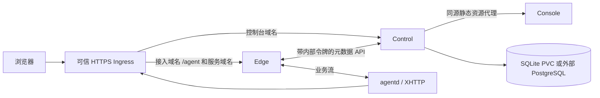

# Kubernetes / Helm 部署

本 chart 将服务端拆为 Control、Edge 和 Console 三个进程、三个镜像、三个 Deployment。它使用当前的单 Control、单 Edge 状态模型；PostgreSQL 或多个 Console 副本不会让 Control/Edge 自动具备高可用能力。

后续 [身份与 Device Flow 设计](identity-and-device-flow.md) 将增加独立 Hydra、数据库、迁移/设备 client 初始化和受保护的 Admin API，并取消接入及配置变更的人工审批。该部分尚未进入当前 chart；以下审批相关描述与部署参数均为现有版本行为，不要将设计中的 Hydra 参数当作已支持 values。



管理 API、注册、审批、浏览器/OIDC 登录在 Control。Edge 查询 Control 的身份/路由决策并维护 provider 会话，业务正文留在 Edge↔agentd 路径。Console 不持有管理员、内部 RPC 或数据库 Secret；Control 代理它的静态资源时会剥离浏览器认证头和 Cookie。

## 准备与安装

要求 Kubernetes 1.26+、可用的 Ingress Controller，以及 namespace 内预先存在的凭据和 TLS Secret。默认镜像支持 Linux amd64/arm64。私有 GHCR 镜像需配置 `imagePullSecrets`，chart 不创建 registry 凭据。

```sh
kubectl create namespace agents
kubectl -n agents create secret generic agents-credentials \
  --from-file=admin.token=/secure/agents/admin.token \
  --from-file=internal.token=/secure/agents/internal.token

helm install agents oci://ghcr.io/bit-precise/charts/agents \
  --version 0.1.0 --namespace agents --values values-production.yaml
```

两个令牌应分别来自至少 32 字节随机数，文件为一行文本，并保存于密码管理器等安全位置。需要 PostgreSQL 时在同一个 Secret 中增加 `database-dsn` 文件键。不要将真实令牌或 DSN 写入 values、Git、日志或 `--from-literal` 命令行。chart 从不自动生成秘密，不在 ConfigMap 中嵌入秘密值。

[Chart README](../charts/agents/README.md) 给出完整的生产 values 示例和参数表。也可以从本仓库安装：

```sh
helm upgrade --install agents ./charts/agents \
  --namespace agents --values values-production.yaml --wait --timeout 5m
```

## 公网域名、路由与 TLS

例如实例域名为 `agents.example.com`：

| 域名 / 路径 | Ingress 后端 | TLS 覆盖要求 |
|---|---|---|
| `agents.example.com` | Control | 实例控制域名 |
| `connect.agents.example.com/agent` | Edge | 接入域名 |
| `*.workspace1.agents.example.com` | Edge | Workspace 1 的一层 wildcard |
| `*.workspace2.agents.example.com` | Edge | Workspace 2 的一层 wildcard |

也可将 `/agent` 放在控制台同一个 host；chart 在该 host 下将 `/agent` 路由到 Edge、`/` 路由到 Control。Console 没有公网 Ingress 规则。

`*.agents.example.com` 只覆盖一个额外 label，不能覆盖 `demo.workspace1.agents.example.com`。为每个 Workspace 显式配置 DNS、`ingress.serviceHosts` 与 TLS Secret；证书可包含多个 SAN，也可每 Workspace 使用一张 wildcard 证书。chart 会拒绝错误层级的服务 wildcard。具体服务仍需 PublishedRoute、批准的 provider 与有效 Grant，wildcard 不授予访问权。

三个组件在集群内监听明文 `:8080`，ConfigMap 固定 `tlsOffload: true`，公网 URL 必须是 HTTPS。可信 Ingress 必须完成实际 TLS 终止并保留正确的 Host；不要将组件 Service 改为无认证的公网 HTTP 入口。默认 `ingress.tls: []` 依赖 Controller 默认服务器证书，部署者必须确认其覆盖所有公网名字。

XHTTP `packet-up` 和长响应需要 Controller 正确保留流式上传/响应、取消和长连接。ingress-nginx 可参考：

```yaml
ingress:
  annotations:
    nginx.ingress.kubernetes.io/proxy-buffering: "off"
    nginx.ingress.kubernetes.io/proxy-request-buffering: "off"
    nginx.ingress.kubernetes.io/proxy-read-timeout: "3600"
    nginx.ingress.kubernetes.io/proxy-send-timeout: "3600"
```

其它 Controller/CDN 的设置不同，HTTP/2 支持本身不证明流式请求可用。发布前需要用实际入口验证 SSE、WebSocket、上传下载、TLS Egress、空闲超时和断线重连。

## 数据与文件权限

默认 SQLite 创建一个 `ReadWriteOnce` PVC，由唯一 Control Pod 挂载 `/var/lib/agents`。进程以 UID/GID `65532` 在里面创建 `/var/lib/agents/state`，模式为私有 `0700`；SQLite 文件位于该子目录。不要把 PVC 卷根直接设置为 stateDir，因为卷根通常由 root/fsGroup 管理，不能满足客户端锁组件的 owner/mode 检查。

默认 `fsGroup: 65532` 和 `fsGroupChangePolicy: OnRootMismatch` 使新卷可写，同时避免重启时递归扩大已有 state 子目录权限。CSI 驱动必须保留私有子目录 owner/模式；改变 UID、fsGroup 或存储驱动之前需验证已有数据权限。

`persistence.retain: true` 为 chart 创建的 PVC 添加 Helm keep 标记。卸载不会删除这类 PVC；重新安装可通过 `persistence.existingClaim` 显式引用。备份与恢复仍由部署者负责。`persistence.enabled: false` 使用 emptyDir，Control Pod 重建将丢失用户、设备、策略与审计，只适合测试。

外部 PostgreSQL 使用：

```yaml
database:
  type: postgres
secretKeys:
  databaseDSN: database-dsn
```

只有 Control 挂载 DSN 文件并打开 SQL 连接；此模式不创建 PVC，Control 的私有进程锁目录仍使用临时卷。数据库用户需要执行项目显式 schema 迁移的权限。部署前配置备份、连接容量和 TLS 服务器验证；私有 CA 可通过受控自定义 Control 镜像加入信任根，不应关闭验证。

Secret 以 `0440` 投影给相应组件，服务端允许 Kubernetes 的受控 Secret symlink/root:fsGroup 读取。agentd 客户端的私有文件校验没有放宽。Container 默认非 root、只读 rootfs、drop ALL capabilities，只有 Control state 卷与各 Pod 的有界 `/tmp` 可写。ServiceAccount 不挂载 Kubernetes API Token，也没有额外 RBAC。

## OIDC

```yaml
oidc:
  enabled: true
  issuer: https://id.example.com
  clientId: agents
  existingSecret: corporate-oidc
  clientSecretKey: client-secret
  scopes: [openid, profile, email]
  bootstrapAdminSubjects: ["exact-subject-from-configured-issuer"]
  adminEmails: ["operator@example.com"]
```

IdP callback 精确注册为 `<public.serverURL>/auth/oidc/callback`。不配置 `clientSecretKey` 时使用 public-client PKCE；配置时仅 Control 挂载该 Secret，默认复用根 `existingSecret`，也可用独立 `oidc.existingSecret`。

`bootstrapAdminSubjects` 仅在该 issuer/subject 首次创建本地用户时生效，不在每次登录时提升管理员权限。新 OIDC 用户和通过 API 创建的用户会获得 `personal-<userID>` Workspace，初始仅该用户为 owner；重复登录不重复创建，已有用户不补建。内部 bootstrap 管理员不自动创建个人空间。普通用户访问其他 Workspace 仍需相应的成员关系或授权；实例管理员和 Workspace owner 是不同权限。

`adminEmails` 是实例管理员邮箱名单，仅接受已验证 ID token 内的 `email`，且 `email_verified` 必须为 JSON 布尔值 `true`，字符串 `"true"`、缺失或 false 均不授予权限。邮箱去除首尾空白并转小写后按完整地址匹配，不匹配域、后缀或邮箱别名，也不按邮箱合并账号。非空名单自动补充 `email` scope；即使 discovery 未列出该 scope 也会请求，IdP 必须实际返回邮箱与验证声明。已有用户加入名单后，要重新完成 OIDC 登录才提升权限；启动不根据历史邮箱声明提升用户。

删除名单邮箱、更换 issuer 或关闭 OIDC 后，Control 在启动期间撤销相应的邮箱派生管理员权限，旧用户 Bearer token 的管理员能力也随之失效。下一次登录若不再提供经验证的匹配邮箱，也会撤销该来源权限。手动创建及 bootstrap 管理员来源保留。手工禁用最后一个有效管理员的保护不阻止配置策略撤权：即使会失去最后一个邮箱管理员，也必须撤销已失效的授权。应保留独立 bootstrap 管理入口；极端情况下通过可信配置及新的已验证 OIDC 登录恢复管理员权限。配置更新通过 chart checksum 触发重启，不支持进程内热加载名单。

服务端不保存或刷新 IdP tokens；浏览器登录会话上限为 ID token 的剩余期限与 8 小时的较小值。

Control 启动时需要 issuer discovery 可达。OIDC login state、授权 code 和浏览器会话在当前单进程内存中；Control 重启会使未完成登录和现有会话失效，需要重新登录。不能直接增加 Control 副本解决这类状态归属问题。

## NetworkPolicy 与内部边界

默认 `networkPolicy.enabled: false`，避免假定集群的 Controller、DNS 和数据库地址。启用后请先确认 CNI 实际支持 NetworkPolicy enforcement，并调整：

- `ingressFrom`：真正的 Ingress Controller namespace/pod selector。
- `dnsPeers`：集群 DNS；使用 NodeLocal DNS 时需要匹配相应地址。
- `postgresEgress`：数据库地址与端口，默认例子放行 TCP/5432，应收紧到实际目的地。
- `oidcEgress`：开启 OIDC 时的 issuer HTTPS 地址/端口，默认 TCP/443。
- `extraEgress`：分别为 control、edge、console 添加必要规则。

策略默认仅允许 Control↔Edge 元数据通信、Control→Console 静态代理，以及相关 DNS/数据库/IdP 出站。Console 不接收公网 Controller 流量，默认无出站权限。内部 API 还独立验证共享令牌，网络位置不是身份凭证。

## 升级与运行检查

Control 和 Edge 使用 `Recreate` 且限制单副本。升级、内部令牌轮换或 Pod 故障会中断现有会话；agentd 重连后建立新流，不重放已发送的应用数据。Console 可多副本滚动更新。

外部 Secret 内容变化不会触发 checksum rollout。协调更新 `internal.token` 后重启 Control/Edge；不存在自动双密钥宽限协议。OIDC client secret 或 PostgreSQL DSN 更新也需要 Control 重启。保持 bootstrap 管理员身份与数据库一致，不要在升级时无意替换所有秘密。

```sh
kubectl -n agents get deployments,pods,services
kubectl -n agents logs deployment/agents-control
kubectl -n agents logs deployment/agents-edge
helm get values agents -n agents
```

默认 startup/readiness/liveness 都使用 `/healthz`。它表示组件进程响应，不代表 SQL、Control、provider 或 IdP 完整可用；控制台中的 Edge 状态、身份错误和实际业务请求仍需检查。

## 自动化验证

```sh
helm lint charts/agents --strict
python3 -m unittest discover -s charts/agents/tests
bash scripts/test-helm-deployment.sh images
```

结构测试仅依赖 Helm 和 Python 标准库，覆盖组件数量/命令、单 writer、Secret 隔离、PVC、OIDC、Ingress 层级及 NetworkPolicy 模板。kind 脚本需要运行中的 Docker、kubectl、curl、tar、Python 3，以及当前架构的三个 image tar：

```text
images/agents-control.tar  -> agents-control:ci
images/agents-edge.tar     -> agents-edge:ci
images/agents-console.tar  -> agents-console:ci
```

脚本从官方发布地址下载 kind `v0.33.0` 与 Helm `v4.3.1`，使用仓库中固定的 SHA256 校验，工具只保存在临时目录。它创建独立随机名称的集群和 kubeconfig，加载原生镜像、生成不输出到日志的临时现有 Secret，并安装非持久模式的 chart。

验收包含三个 Deployment rollout、实际 `0700` state 子目录和 `0440` Secret 投影、组件 `/healthz`、Control→Console HTML/资产代理、管理员登录、Control→Edge 元数据认证及无内部令牌返回 401。脚本只在自己的 kind 节点查看文件模式，不读取 Secret 内容作诊断；无论成功失败都会清理自己的集群、port-forward 和临时文件，不使用当前 kubectl context。

该冒烟通过本机 port-forward 访问后端，明确关闭 Ingress 和 NetworkPolicy。它不验证真实公网证书、CDN 行为、CNI enforcement、外部 PostgreSQL 或外部 OIDC IdP；这些需在对应环境另行验收。
