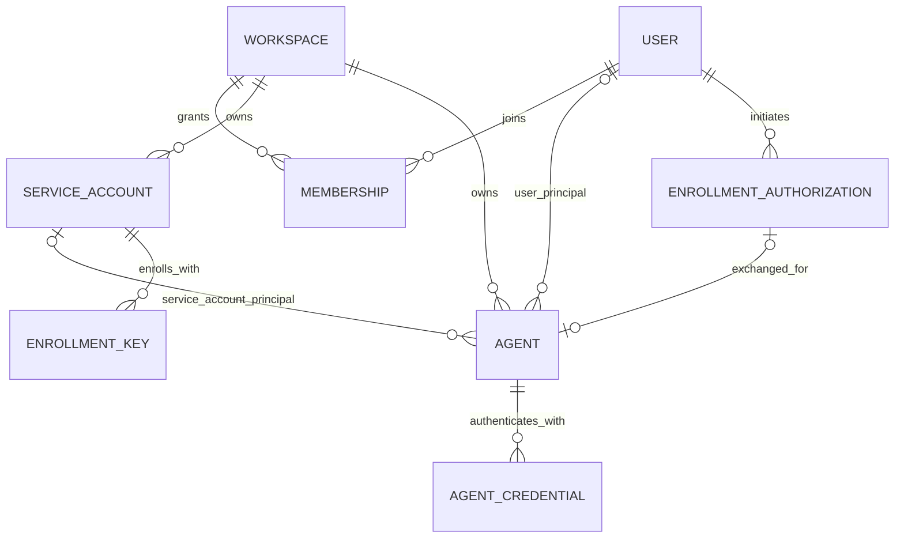
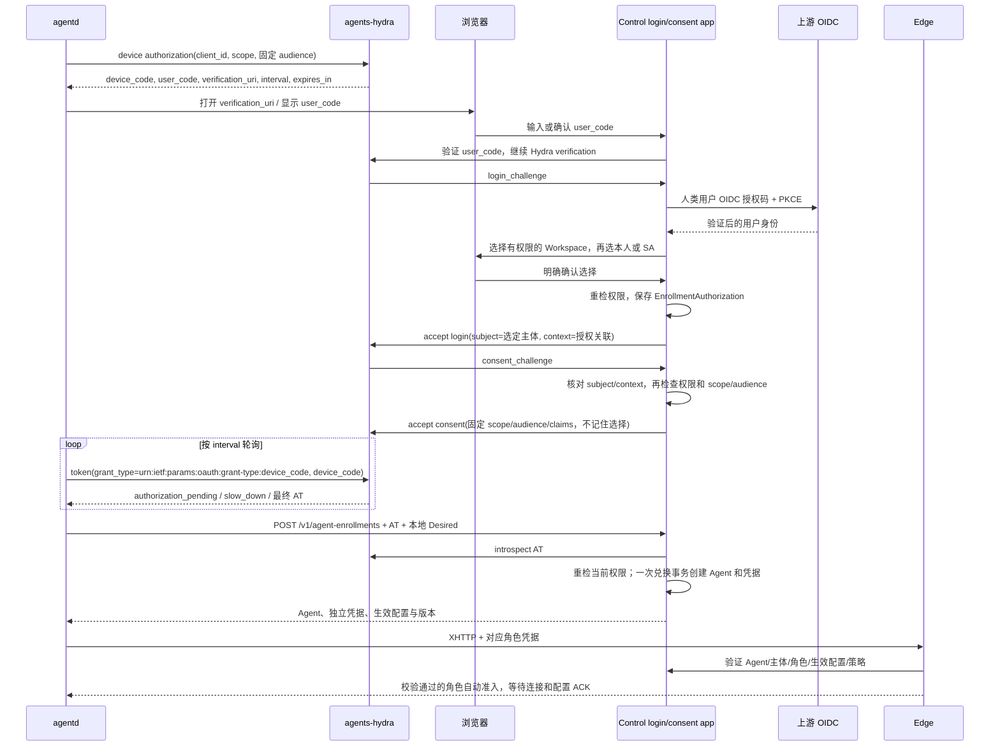

# Workspace、运行主体与 OAuth Device Flow

状态：2026-10-18 确认的目标设计，待实现。实现基线为 agents `f695037`、agentd `6bc1113`。当前版本尚无 Service Account、agents 专用 Hydra 或 `agentd login` Device Flow；现有 OpenAPI、配置 Schema 和运行手册仍描述已交付接口。本次修改不改变线上认证行为。

本文是后续身份改造的依据，优先于早期架构草案中“所有 Agent 绑定 User”“所有 access 会话只能表示 User”的描述。

接入和配置变更均不设置人工审批流程。用户本人完成 OAuth 登录与 Workspace/身份选择后，Control 自动执行权限和策略校验，通过即注册并签发凭据；不通过直接拒绝。没有额外审批人、审批队列、待审批状态或设备批准按钮。当前代码中的 `Approval`、`pendingApproval` 和 `/approval` 是待移除的旧模型。

## 1. 已确定的模型

资源归属与运行身份分开：Agent 属于一个 Workspace，运行时恰有一个主体 `principal = User | ServiceAccount`。创建/登录操作人的记录不赋予设备所有权或长期运行权限；操作当下仍须验证这个人的身份与权限，之后保留为审计关联，不能替代运行主体。

| 对象 | 归属与约束 |
|---|---|
| User | 实例级人类身份，由上游 OIDC 的 issuer + subject 识别；通过 Membership 加入多个 Workspace |
| Membership | User 在一个 Workspace 的 owner / maintainer / developer / guest 角色；不用于给 SA 分配人类角色 |
| ServiceAccount | 只能属于一个 Workspace；Workspace 创建后不可更改；可以对应多个 Agent |
| Agent | 固定 Workspace 和唯一 `principalType + principalId`；同一个 Agent 可同时承担 ingress / serve / egress |
| EnrollmentKey | 无人值守注册的引导凭据，绑定一个 SA、同一 Workspace、角色上限、次数、期限与机器校验策略 |
| EnrollmentAuthorization | Control 保存一次 Device Flow 的选择及授权来源，关联 Hydra challenge、操作人、Workspace、主体和兑换状态 |
| AgentCredential | 每个 Agent 独立的 control / access / provider 凭据；不能以一份共享 SA 运行秘密代替所有设备凭据 |
| Grant | 授予业务访问权限，与成员管理权限、设备注册和 provider 能力校验分别判断 |



图中的 User / SA 两条 Agent 主体关系是 XOR，不是两个可同时设置的 owner。存储层必须约束：

- `principalType=user` 时，User 有效且是该 Workspace 的有效成员；不能由客户端指定另一个人的 User ID。
- `principalType=service_account` 时，SA 有效，且 `SA.workspaceId == Agent.workspaceId`。
- Agent 的 Workspace 和主体注册后不可通过 PATCH、重载、重连或换 Token 静默改变。
- 同一 SA 的多个 Agent 共享该 SA 的业务授权，但有不同 Agent ID、凭据、生效配置版本、连接和撤销边界。单设备凭据隔离不等于同 SA 的业务权限隔离。
- `createdByUserId`、`actorUserId` 和设备请求的 actor 单独记录。SA 创建者离职或降权不自动停止已获准的团队设备。

个人设备可以使用本人身份；服务器用途的 profile 必须使用 SA。Device Flow 同时提供本人/SA 选择，选择 SA 后就是机器 profile。服务器安装入口和 Control 的注册策略必须拒绝 User 主体的 server profile；不能仅凭操作系统、主机名或客户端自报硬件类型声称识别了所有物理服务器。

## 2. 权限与身份选择

| 操作 | instance admin | owner / maintainer | developer | guest |
|---|---|---|---|---|
| 以本人 User 注册个人 Agent | 仍需该 Workspace Membership | 本人 | 本人 | 本人，角色仅 ingress |
| 管理 SA、SA 注册密钥及 SA 设备 | 可跨 Workspace 管理，显式审计 | 仅本 Workspace | 否 | 否 |
| 在 Device Flow 中选择 SA | 显式管理特权，记录原因/主体 | 仅本 Workspace 的有效 SA | 否 | 否 |
| 管理个人设备 | 管理权限 | 本 Workspace 管理权限 | 仅主体为自己的设备 | 仅自己的 ingress 设备 |
| 以本人身份声明 serve / egress 配置 | 需有效 Membership，自动校验 | 本人配置，自动校验 | 本人配置，自动校验 | 否 |

正常 Workspace 列表来自当前用户的有效 Membership，不因为完成 OIDC 登录就自动加入空间。默认优先选择 `personal-<userId>`。instance admin 可以在显式管理视图选择其他 Workspace 的 SA；若选择“本人身份”，仍须先具有该 Workspace 的 Membership，不能借全局管理权限制造业务成员身份。

SA 不具有 `User.admin`，也不作为一个隐藏 User 或人类 Membership 记录。SA 列表、完整详情、创建、更新、撤销、发注册密钥和“以此 SA 注册设备”都要求 maintainer 及以上；降为 developer 后不会因 `createdBy` 仍能管理它。其他成员能看到的设备/路由摘要不意味着可以管理对应 SA。

## 3. Hydra 与 Control 的分工

引入 **agents 专用的 Hydra OAuth Authorization Server**，实现 RFC 8628，不自行实现另一套 device-code grant。

| 组件 | 责任 |
|---|---|
| 上游 OIDC Provider，例如 Connect | 验证真实人类用户；其 issuer/sub 继续绑定 agents User |
| agents-hydra | device_code / user_code、轮询、OAuth grant、access token 签发及 introspection / revocation |
| Control 的 login / consent app | 上游 OIDC 登录、Workspace/主体选择、权限重检、完成 Hydra login/consent challenge、注册兑换与审计 |
| Console | 展示验证、选择、确认和 SA 管理页面；没有最终授权判定权 |
| agentd | 同一二进制支持 Device Flow；保护 device_code / access token，兑换后保存本机 profile 凭据 |
| Edge | 仅接受 agents 数据面凭据，认证确定的主体并检查每条业务流；不接受 Hydra 注册 AT 直接建隧道 |

上游 Connect 与 agents-hydra 是不同职责和 issuer。不能只复用 Connect 的普通登录结果，因为最终 AT 还必须绑定 agents Workspace 和选定主体；也不能把 Connect 的 `client_secret` 放进 agentd。

Hydra 是 OAuth 服务，不提供本产品的 Workspace/SA 选择和 RBAC。设备 public client 仅允许 device-code grant，`token_endpoint_auth_method=none`，不分发 client secret；不允许它获得任意 audience、管理 scope 或绕过选择的自动 consent。已有 Connect Device Flow 能力可供实现参考，但不作为 agents 的部署依赖或已验证承诺。

## 4. Device Flow：先认证人，再确定设备身份



Workspace 和身份选择发生在浏览器验证页，CLI 显示最后确认的选择。浏览器可以复用上游人类 SSO，但每次设备授权都必须重新展示并确认 Workspace 和主体，不能套用上次设备的选择。

所有选择、同意和拒绝提交必须校验同源 Origin、CSRF、当前人类会话和绑定的 OAuth 浏览器事务。Control 将 Hydra challenge 与自己的 HttpOnly/Secure/SameSite 浏览器事务关联；上游 OIDC 保留 state、nonce、PKCE 和精确 callback 校验。challenge 或 user_code 本身不是用户授权，不能只凭它们加一个 manager Cookie 接受任意选择。确认页展示本次验证码和客户端，要求用户核对发起授权的设备；身份切换、事务到期/消费或 challenge 不匹配后拒绝旧提交，不因记住登录而自动确认。

可复用的人类会话必须有已验证的上游 OIDC 来源和绑定 User；应急 Token 登录不能被伪装成一次 OIDC 验证。SA 选择不更改这个人类浏览器身份。

### Hydra subject 必须在 login 阶段固定

Hydra 的 `AcceptLogin.subject` 决定后续 grant 的 subject。`AcceptConsent` 负责 scope、audience 和 token session 扩展，不能在这个阶段把 User 换成 SA。因此：

1. Control 先获得真实 User 的 OIDC 身份，再完成 Workspace/主体选择。
2. Control 建立不可由客户端改写的 EnrollmentAuthorization，记录 `actorUserId` 与 `effectivePrincipal`。
3. 完成 Hydra login 时，subject 使用类型化的选定主体，例如 `user:<uuid>` 或 `service_account:<uuid>`，不使用 email/name。
4. consent challenge 的 client、subject、login/context 关联必须与该记录一致。存在 remembered login 的 `skip` 时不能直接跳过选择或改写已有 subject；必须重新开始可正确绑定主体的授权。
5. 专用设备 client 不记住 Hydra login/consent 的 Workspace/SA 选择，不签发供 Console 使用的 ID token。Control 的浏览器 Cookie 始终只代表真实人类 User。

用户选择 SA 是一次受控机器身份授权，不是 SA 自己完成 OIDC，也不建立 SA 的 Console session。后端 `/v1/sessions`、用户 Token 登录及管理 Bearer 验证必须显式拒绝 SA 和设备用途凭据，不能仅在 UI 隐藏入口。

### 注册与配置自动校验，不增加人工审批

标准 RFC 8628 不保证传递任意 agentd Desired 配置。不能假设把完整配置塞进自定义参数就能被 Hydra 原样带到 login/consent。

Device Flow 冻结 Workspace、主体、操作人和角色上限；兑换时上传 Desired。Control 在同一个注册事务中校验角色权限、资源归属、服务名称、origin/域名规则、配额和 Workspace 策略，通过后创建可运行的 Agent、计算 `EffectiveConfig` 并签发凭据；失败直接返回具体错误，不创建待人工处理的设备。

后续增加服务、改变源站或出口范围也走相同的自动校验和条件版本更新。越权返回 403，非法配置返回 400，名称/版本竞争返回 409；用户修正配置后重试，不进入待审批队列。成功更新产生新 effective revision，完成下发、ACK 和实际连接后 ready；`syncing`、`connecting`、`offline` 描述运行状态，不是审批状态。配置不合法时，只保留仍符合当前策略及本地限制的上一份有效配置并报告失败，本地停用/收紧仍立即生效。agentd 后续更新以独立设备凭据、当前 User/SA 主体及策略校验；SA 设备不重新依赖历史 `actorUserId` 的 Membership。通过管理 API 修改时，则校验本次实际操作人的当前管理权限。

`EffectiveConfig = Desired ∩ 主体角色上限 ∩ Workspace 策略`。它是服务端按规则计算的结果，不是人工批准记录。接入或配置生效本身不代表业务已可访问：Grant 仍来自明确的资源授权或既有 Workspace 默认策略，不能因设备接入隐式扩大受众。ingress 使用真实 User/SA 的 Grant，Serve/Egress 路由保持独立授权判断。

Workspace 未设置覆盖规则时使用版本化的内置策略：按本文角色矩阵、注册角色上限及既有名称、origin、域名和拨号安全约束校验；不能把缺失策略字段解释为任意允许。实现需明确这些默认值、策略来源和版本。迁移从既有角色上限与配置约束映射，无法可靠映射的配置明确拒绝并说明原因，不以“语法合法”代替权限判定。

OAuth consent 只是当前用户完成本次身份选择授权，Control 在必要校验后调用 Hydra 的 accept API。它不是另一位管理员审批设备，Console 不再出现“设备待批准”或“批准配置”页面。

## 5. Access token 与一次兑换

首版优先使用 Hydra opaque access token，Control 通过受保护的 Hydra Admin introspection 验证。不得只校验一个自报 workspace header，也不得把未经验证的 JWT 内容当授权。

目标 AT 只具有 `agents:enroll` scope，audience 限于本 Instance 的设备注册兑换，例如 `urn:agents:<instanceId>:agent-enrollment`。CLI 必须按锁定 Hydra 版本支持的 `audience` 参数在 device authorization 请求中明确申请该值；设备 client 的 audience 白名单、consent 的 requested/granted audience 和 Control 兑换验证都精确匹配同一个值，不能省略后假定 Hydra 自动赋予。这个 audience 参数属于需要验收的 Hydra 扩展，不是 RFC 8628 对任意 provider 的通用保证；版本不支持时不得退化为接受无 audience Token。

Hydra 返回标准 `access_token`、`token_type=Bearer`、`expires_in`、`scope`。应用扩展或可信服务端关联至少包含：

```json
{
  "authorizationId": "control-generated-id",
  "workspaceId": "selected-workspace-id",
  "principal": {"type": "service_account", "id": "selected-sa-id"},
  "actorUserId": "oidc-authenticated-user-id",
  "allowedRoles": ["serve", "egress"]
}
```

这是应用级授权上下文示意，不规定 Hydra JWT 的顶层布局；opaque token 的数据由 introspection 与 Control 的授权记录共同确认。不能让 public client 设置这些可信字段。`sub`、扩展上下文及服务端授权记录不一致时拒绝。

- 建议设备授权请求有效 10 分钟、AT 有效 5 分钟；轮询初始间隔以 Hydra 响应为准，省略时按 RFC 使用 5 秒，`slow_down` 每次再增加 5 秒。轮询必须串行，成功、拒绝、过期或 `invalid_grant` 后停止，不重复消费已成功的 device_code；部分 Hydra 版本会因此撤销派生 Token。网络故障单独退避，不能通过并发轮询补偿。
- 设备 client 不请求 `offline_access`，首版不下发 refresh token。长期运行依赖独立的 Agent 凭据，不依赖保存人类浏览器会话或 SA 共享密码。
- AT 不能用于 Console、普通管理 REST、Serve Cookie、XHTTP GET/POST 或 HELLO。角色凭据也不能反向用来登录 Console。
- 兑换时校验 issuer、active/expiry、client、scope、audience、授权记录和主体；再次检查人类操作人当前仍有效并有相应权限。
- User 选择只允许本人；SA 选择要求操作人此刻仍为同 Workspace maintainer/owner，或具有显式 instance-admin 特权。SA 必须有效且 Workspace 完全匹配。
- OAuth 成功不允许兑换请求另填 `userId`、`serviceAccountId`、Workspace 或 role 来覆盖已确认选择；Desired 中的 Workspace 只是与可信上下文核对的声明。

### 原子性和重试

标准 device-code 轮询成功一次，不代表 AT 只能注册一个 Agent。Control 必须以唯一 `authorizationId` 建立兑换记录，并与 Agent、设备凭据及审计的创建放在同一事务中；并发兑换最多一次成功。同一 SA 的另一台设备重新执行 Device Flow，或使用有明确使用次数的 SA EnrollmentKey。

授权 ID 由 Control 的 login/consent app 生成并关联 Hydra grant；可再保存 AT 指纹用于拒绝替换，但不存 AT 原文。不能依赖 opaque token 一定具有 `jti`。Control 授权记录具有 `awaiting_user / authorized / consumed / revoked / expired` 状态和期限；外部 introspection 后，在消费记录与创建设备的同一事务中检查其仍为有效 authorized，并检查当前权限，避免确认与兑换之间的降权竞争。

产品内的授权撤销先在 Control 原子标记记录 revoked，再撤销 Hydra grant/token；它与兑换消费串行化，不能先检查状态、稍后另起事务创建设备。Hydra introspection 与 Control 提交不属于同一个数据库事务：绕过 Control 直接从 Hydra 撤销时，若撤销发生在成功 introspection 之后，本次在途兑换仍可能成功。不能承诺跨系统零窗口撤销；需要同步撤销记录，并通过 Control 明确撤销已经兑换的设备。Hydra 已在 introspection 时返回 inactive 或 AT 已过期则必须拒绝。

首次兑换返回 `201`、Agent Location 和一次性明文设备凭据。已消费授权再次兑换返回明确的已消费/冲突结果，不再创建第二个 Agent，也不能重新读取旧凭据原文。响应丢失时进入受控恢复，并重新验证当前权限：SA 设备仅当前 Workspace manager/instance admin 可以恢复；User 设备仅当前有效本人加 Membership，或当前 manager/instance admin 可以恢复。原操作人身份本身不赋予恢复权。经授权识别该次兑换的 Agent 后撤销未接管的设备凭据，再发起新授权；若以后提供幂等秘密重放，必须另有短时加密存储及设备持有证明，不能为了重试明文保存秘密。

## 6. 设备凭据与业务授权

Control 为每个 Agent 单独签发用途隔离的 control / access / provider 凭据。认证结果携带不可由 HELLO/OPEN 覆盖的 `instanceId, workspaceId, agentId, principalType, principalId, credentialId, role, expiry`。设备角色限制、Desired ∩ RoleCeiling ∩ WorkspacePolicy、路由、Grant 和有效期限继续分别检查。

Grant 新增显式 `service_account` subject，稳定 ID 指向 SA：

| subjectType | 匹配范围 |
|---|---|
| `user` | 对应真实 User 主体，包括其有效个人 Agent；不匹配操作人恰好是该 User 的 SA |
| `service_account` | 对应 SA 主体；同 SA 的多个 Agent 共享这份主体授权，仍受各设备能力限制 |
| `workspace` | 保留现有语义：该 Workspace 的有效人类成员，不自动扩大为其中所有 SA |
| `anonymous` | 仅现有明确允许匿名访问的 Serve 路径，不能成为出口授权 |

Egress 仍要求请求主体与路由在同一 Workspace：User 通过 Membership，SA 通过其固定 Workspace 归属。不能合并 Workspace 中所有 User 的 Grant 给一台 ingress，也不能让 SA 使用其创建者/操作人的 User Grant。

Serve 的提供方可以是 User 或 SA Agent；访问服务的浏览器仍是独立的 User/anonymous 消费者，不能被替换为 provider 的主体。现有浏览器 Serve 入口不接受设备或注册 Token。机器消费受保护 Serve 的路径必须显式支持 typed principal 和独立的业务凭据用途，方可开放该路径上的 SA Grant；不能通过接受 provider/control/access Token 作为浏览器用户来补齐。

管理 REST 权限与业务 Grant 独立。developer 对“自己的设备/服务”的判断改为 `principal.type == user && principal.id == actor.id`；管理 SA 设备要求 manager 权限。`createdByUserId` 永远不参加这类权限判断。

## 7. 生命周期与撤销

| 事件 | 目标行为 |
|---|---|
| OAuth AT 过期、introspection 返回 inactive，或 Control 授权记录先被撤销 | 拒绝兑换；Control 撤销与消费同事务串行化，直接 Hydra 撤销的在途竞争按上述一致性边界处理 |
| 操作人在兑换前降权、禁用或离开 Workspace | 重新检查后拒绝兑换，尤其不能继续注册 SA 设备 |
| SA Agent 已兑换后，操作人/创建者离职 | 设备继续按 SA 自己的状态与授权运行，不继承该人的生命周期 |
| User 被 Control 禁用 | 其 User 主体设备失效；其他 SA 设备不受影响 |
| User 移出某 Workspace | 保留现有永久撤销语义：撤销其中该 User 主体的设备/凭据；重新加回成员不自动复活 |
| SA 被停用/撤销 | 该 SA 的未使用注册密钥、设备准入、续期与业务授权失效，关闭关联会话和 Flow |
| 单个 Agent 被撤销 | 只撤销该 Agent 的全部用途凭据、会话和 Flow；同 SA 的其他设备继续运行 |
| 单个 SA 注册密钥过期或撤销 | 阻止后续注册，不自动撤销已经独立签发凭据的 Agent；需要通过 Agent/SA 操作撤销已注册设备 |
| 角色收紧或 Grant 撤销 | 重算受影响业务；不能因同连接还有其他有效角色而漏掉撤销，也不能杀掉无关流 |
| 浏览器退出或注册 AT 正常到期 | 不等于撤销已独立签发的 Agent 凭据 |
| `agentd logout` | 撤销当前 profile 的设备凭据并清理本地秘密，不禁用整个 User/SA |

首版 SA 撤销为终态，不提供把旧设备和 Token 自动复活的开关。需要恢复时使用明确的新授权/凭据恢复流程；不可撤销身份换 Workspace 或将 User profile 原地改为 SA。未来可单独设计可恢复 suspension，不能与永久 revoke 混用。

Control 的持续权威是当前主体、Membership、Agent、生效配置及 Grant 状态。Hydra 管理的是引导 OAuth grant；对已兑换设备的显式撤销必须通过 Control 的设备/主体撤销操作执行，不能假设撤销 Hydra AT 会自动收回独立凭据。

上游 IdP 账号禁用不会由 OIDC 协议自动实时通知 Control。设计必须区分 Control 已知的禁用与上游状态同步；生产交付需要明确用户目录同步/重新认证窗口及其失效上界，不能声称只凭一次 OIDC 登录就能实时感知外部离职。Control 已知的主体撤销按现有策略更新、会话检查和 Flow 短租约传播；依赖不可用时不延长既有授权期限。

## 8. 目标 REST API 与 Console

以下是待实现契约，不提前写入当前运行时 OpenAPI。实现时必须同时更新服务端校验、OpenAPI、生成 SDK、Console 和 agentd。

| 路径 | 目标方法与权限 |
|---|---|
| `/v1/admin/service-accounts`、`/{id}` | instance admin 全局分页查询/创建/详情/修改/撤销；创建显式指定 Workspace，修改禁止改变归属 |
| `/v1/workspaces/{workspaceId}/service-accounts`、`/{id}` | maintainer+ 的空间内分页查询/创建/详情/修改/撤销；Workspace 仅从路径获取 |
| `/v1/workspaces/{workspaceId}/service-accounts/{id}/enrollment-keys` | maintainer+ 创建无人值守注册密钥，SA 和 Workspace 从路径确定，不接收 User ID |
| `/v1/workspaces/{workspaceId}/enrollment-keys` | 继续独立分页列表/详情/撤销，增加 SA 与 createdBy 筛选；旧 User key 标为 legacy |
| `/v1/agent-enrollments` | Device Flow AT 的单次注册兑换；不接受浏览器 Cookie 或普通管理 Token 代替该用途 AT |
| `/v1/admin/agents`、`/v1/workspaces/{workspaceId}/agents` | 保留现有资源层级，使用 `principalType/principalId` 筛选，`createdBy` 独立显示 |
| 旧 Agent `/approval` 端点与 `pendingApproval` 字段 | 在实现迁移中移除；以自动校验、生效配置/版本及明确的失败状态代替，不增加新的审批接口 |
| Workspace 的 `/grants` | 增加显式 SA subject；校验实际资源权限、SA 归属以及消费路径是否支持该主体 |

SA 管理要求 maintainer+；给 SA 授业务权限还必须具备对应资源的授权管理权。所有集合沿用 `{items, pagination}`、页码/页大小、服务端筛选排序；不恢复聚合快照接口。SA 只有机器用途凭据，不通过 `/v1/sessions`、`/v1/users/me` 或 User Token 路径取得人类身份。

Console 增加 Service Accounts 管理页面及设备主体列。创建服务器注册密钥时选择 SA，不再选择“注册用户”，也没有 `autoApprove` 选项。Device Flow 页面依次展示登录用户、Workspace、可选主体和最终确认；User 选项永远是本人，只有具备权限时才展示可选 SA。设备页展示 Desired、生效配置、同步状态和校验错误，移除审批按钮与待审批筛选。

agentd 在同一二进制内提供 `agentd login --config FILE` 和 `--no-browser` 形式的 Device Flow（均为待实现命令）；支持系统浏览器和复制 verification URI/user_code。既有 `enroll --key-file` 保留为无人值守路径，新密钥只能绑定 SA。配置文件只表达实例、Workspace 提示及本地角色；实际 Workspace/主体来自可信授权结果并保存到私有 profile，修改 YAML 不能改绑。

## 9. Helm 与组件部署

新增 Hydra Deployment、public Service、仅内部可达的 admin Service、独立数据库/数据库账号、迁移 Job 和专用设备 client 初始化。Hydra 使用经过 Device Flow 验收的固定镜像 digest；不把开发分支或其他项目的定制镜像直接当成 agents 的兼容性承诺。agents 自己的镜像仍为 Control/Edge/Console，Hydra 是单独的 OAuth 依赖。

Hydra public issuer 可以使用单独域名，也可以与 Console 同源，由明确的 Gateway 路由暴露标准 discovery、device authorization、verification 和 token 路径。必须按部署版本的 discovery/OpenAPI 确定路径，不能把整个 Hydra Admin 路由反代到公网。Control 的 login/consent/verification 页面也必须有固定 URL 和精确 callback。

Hydra Admin 默认不应被当作公开认证边界：ClusterIP 本身不是授权。NetworkPolicy/服务身份必须将 Admin API 限制给 Control 和指定初始化组件；跨信任边界时增加受认证的服务通道。Hydra 与 agents 业务数据使用独立 DB/schema 和账号，Cookie/system/signing secrets 放 Kubernetes Secret，支持按官方流程轮换及备份。

后续 Helm values 需区分上游 `oidc` 与本实例 `hydra` / authorization server 配置，不能把上游 OIDC client secret 当作 agentd public-client secret。CLI 不包含任何共享 confidential secret。当前 chart 尚未提供这些 Hydra values，本设计不要求立即部署新组件。

## 10. 迁移顺序与验收门槛

1. **显式数据迁移**：当前 DB 最高 v2；下一次迁移新增 SA、typed principal 和兑换关联，SQLite/PostgreSQL 均有约束与事务测试。Agent、key、token 的关系列与 JSON payload 同步迁移，恰有一个主体且 SA 与 Agent 同 Workspace。
2. **保留旧身份与访问边界，去掉审批流程**：所有旧 Agent/设备凭据迁为原 `UserID` 对应的 User principal，保留 ID、Hash、期限、撤销和 Grant 窗口，不全量改成 SA。旧 `Approval` 转为可追溯的历史生效配置并按当前策略重新计算；旧 pending/扩权请求自动重新校验，合法则生效，非法则明确拒绝，不能无条件激活，也不继续等待人工审批。迁移不调用旧 approve 的默认 Grant 创建逻辑，不新增或延长成员/匿名授权；新版本正常创建服务时的默认授权仍按明确的 Workspace 策略执行。撤销状态不得复活。旧 User 注册密钥只兼容至撤销/到期，其 `autoApprove` 开关退出新模型。
3. **审计来源保真**：旧 key 的 `UserID` 可能是代注册目标，并非创建者；只从可信审计回填 createdBy，未知则保留 legacy/unknown，不伪造历史。
4. **统一认证内核**：typed subject 必须贯穿 Control Identity、SDK wire 类型、Edge Principal、Decision、Flow 与续租；不能把 SA ID 填进 `UserID` 冒充兼容。按能力协商/协议版本拒绝不支持 SA 的客户端或 Edge。
5. **Hydra 与兑换**：先验证选定 Hydra 版本的 Device Flow、subject/context 和取消/过期/slow_down 行为，再接入上游 OIDC、Workspace/SA 选择、AT 兑换和审计。exchange 的一次性与权限重检必须独立于 Hydra grant 消费测试。
6. **双仓交付**：更新 agentd CLI/profile/协议与 agents 数据库、REST/OpenAPI、Console/Helm；生成 SDK 和资源，CI 验证真实浏览器、Hydra、Control、Edge、agentd 的完整链路。最后进行可审阅的版本升级和线上迁移。

必须通过的验收包括：

- 本人 User/同 Workspace SA 两种 Device Flow；developer/guest 无法选择或管理 SA；workspace 列表与默认个人空间正确。
- 用户不能借选择参数成为另一个 User；不能选择外 Workspace SA；确认后参数、subject 或 issuer 被换掉时拒绝。
- consent、AT 兑换之间的降权/移除成员会使兑换失败；兑换后的 SA 设备不因操作人离职而失效。
- 同一授权并发兑换只产生一个 Agent；重复/过期/已撤销 AT、错误 audience/client/scope 不能换凭据。
- 合法 User/SA 的注册和三角色配置变更自动生效；无需第二个人操作，不出现待审批字段、队列或按钮。非法配置明确失败，ACK/网络等待不被标成待审批。
- 多个 Agent 使用同一 SA 均可正常运行，单设备撤销不影响其他实例；SA 撤销关闭所有对应实例和活动流。
- User Grant、SA Grant、Workspace 人类成员 Grant 不串用；管理权限不自动产生业务访问权。
- SA、Hydra AT、enrollment/control/access/provider 各类凭据都不能创建 Console User session。
- 快速重复登录不复用旧 Workspace/SA consent；CLI 遵守轮询间隔与 slow_down，设备/Token 秘密不出现在日志、浏览器 URL 或审计中。
- TLS、XHTTP packet-up、路由选择和当前独立角色/流撤权约束保持；不引入新的加密算法或要求 CDN 透传客户端 mTLS。

参考：[RFC 8628](https://www.rfc-editor.org/rfc/rfc8628)、[RFC 7662](https://www.rfc-editor.org/rfc/rfc7662)、[Hydra login/consent](https://www.ory.com/docs/oauth2-oidc/custom-login-consent/flow)、[Hydra Device Authorization](https://www.ory.com/docs/oauth2-oidc/device-authorization)。具体 Hydra endpoint/模型以锁定版本的 OpenAPI 为准；文档示例与不同版本可能存在路径差异，CLI 优先使用 discovery。
