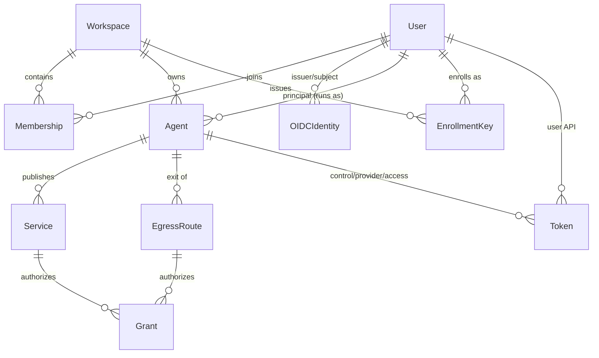
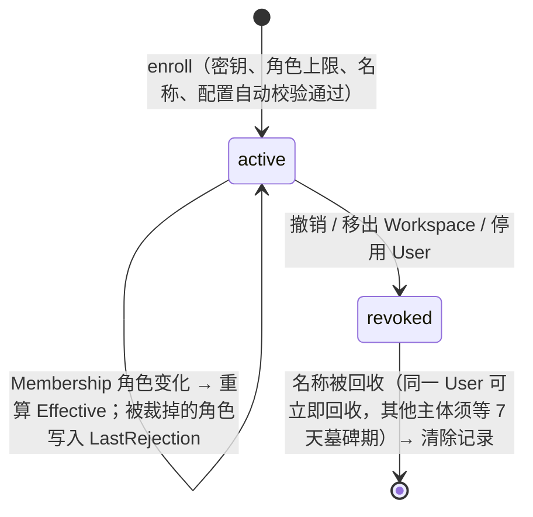

# 实体、状态机与关系（当前实现）

本文是 agents / agentd 当前实现中实体、状态与关系的唯一权威说明，以代码为准：`control/types`、`control/state`、`edge`，以及 agentd 的 `api`、`connection`、`orchestration`、`supervisor`。其他文档描述当前行为时应链接本文，不再各自重复字段、状态或时限。

- **已确定的增量设计**：Service Account 和 Hydra Device Flow，见 [身份与 Device Flow 设计](identity-and-device-flow.md)，尚未实现。
- **远期架构**：Tunnel 分层、gateway 独立进程、分享邀请、证书 worker、多 Edge，见 agentd 仓库的 `docs/agents-agentd-architecture.md`。

设备接入和配置变更都没有人工审批，Control 自动校验后直接接受或拒绝。旧模型里的 `Approval`、`pendingApproval`、`/approval` 和 `autoApprove` 已经删除，存量数据由 DB v3 迁移转换（见第 6 节）。

## 1. 实体

| 规范名 | 代码 | 归属与持久化 | 要点 |
|---|---|---|---|
| User | `types.User` | 实例级；表 `users` | 身份唯一键是 OIDC `(issuer, subject)`，存于 `OIDCIdentity`。`Admin` 即 instance admin；对邮件名单管理的用户，`Admin` 由 `AdminFromEmail` 派生。停用是单向操作 |
| Workspace | `types.Workspace` | 表 `workspaces` | 名称是不可变的 DNS label。新用户自动获得 `personal-<userID>` |
| Membership | `types.Membership` | `(workspace, user)` 复合主键 | 角色为 `owner / maintainer / developer / guest`。删除即退出 Workspace，并级联撤销设备 |
| Agent | `types.Agent`（持久记录）、`api.Agent`（API 视图） | Workspace 内名称唯一；主体固定为一个 User | `Status`、`Roles`（注册角色上限）、`Desired`（AgentSpec）、`Effective`（EffectiveConfig）、`LastRejection`、`RevokedAt`。设计文档称之为 AgentRegistration |
| AgentSpec | `api.AgentSpec` | 存于 Agent 的 `Desired` | 由 config.yaml 派生的服务端相关子集：各角色是否启用、serve 服务名与 origin、egress allow/deny。本地路径、监听地址、承载参数和 ingress routes 不上传 |
| EffectiveConfig | `api.EffectiveConfig` | 存于 Agent 的 `Effective` | `Desired ∩ 角色上限 ∩ Workspace 内置策略`，由 Control 计算，不是批准记录。`Revision` 是每个 Agent 自己的单调计数，只在内容变化时递增。`ExpiresAt` 在读取时填为当前时间加 24 小时，只限制 agentd 离线时还能用多久 |
| EnrollmentKey | `types.EnrollmentKey` | 表 `enrollment_keys`，与同 ID 的 enrollment Token 一起撤销 | `UserID` 是设备将以其身份运行的 User，不是密钥创建者。另有角色上限、次数和期限 |
| Token | `types.Token` | 只保存哈希 | 种类：`user / enrollment / control / provider / access`，用途互不替代 |
| Service | `types.Service` | `(workspace, name)` 唯一，hostname 全局唯一 | 固定属于一个 Agent。Desired 声明服务名时即预留名称，主机名为 `<service>.<workspace>.<base>`。`Enabled` 是管理员的发布开关。API 视图名为 server，route 视图里是 `kind=serve` |
| EgressRoute | `types.EgressRoute` | Workspace 内名称唯一 | 一条域名/端口/TLS 规则加优先级，固定指向一个出口 Agent。只决定选路，不授予访问权 |
| Grant | `types.Grant` | 资源和主体用 XOR 约束 | 资源为 Service 或 EgressRoute，主体为 `user / workspace / anonymous`（anonymous 只能用于 Service）。有限时间窗，`Revoked` 不可恢复。`External` 表示经 manager 授权的跨 Workspace 分享，`CreatedBy` 记录创建者 |
| names | 表 `names` | 每次保存时从 Agents 和 Services 推导 | Agent 名和服务名共用同一个 Workspace DNS 命名空间 |
| Audit | `types.Audit` | 只追加 | `Detail` 记录原因，例如自动拒绝的理由、迁移前的旧审批快照 |

运行期实体只存在于内存，不持久化：

| 规范名 | 代码 | 生命周期 |
|---|---|---|
| Connector | agentd 进程启动时随机生成的 `ConnectorID` | 一个进程一个。同一 Agent 在 Edge 上同一时刻只有一个 provider Connector |
| provider / access 会话 | Edge 的 `provider` 结构体、`connection.Session` | 认证后建立；provider 会话**握手完成后**才写入目录，替换同一 Connector 的旧会话。会话本身不续期，最长 24 小时 |
| Flow | Edge 的 `flow`、两侧各一份 `connection.Stream` | 每条业务流独立一份租约（55 秒，过半续期）和一个硬上限（12 小时）；按内容逐条复核 |
| Decision | `types.Decision` | Control 对一次 Serve/Egress 请求做出的授权决定；`Revision` 是当时出口/服务 Agent 的 Effective revision |

## 2. 关系



- 一个 Agent 同时可以承担 ingress、serve、egress 三种角色。serve 和 egress 共用 provider 会话，ingress 使用独立的 access 会话。
- 角色名与协议名的对应：本机角色 `ingress` = 会话角色 `access` = 流用途 `access` = `AccessToken`；本机角色 `serve` / `egress` = 会话角色 `provider` = 流用途 `serve` / `egress` = `ProviderToken`。`ingress` 只指本机访问角色；旧文档中的 IngressRule 现称 ServeOriginRule，是 Serve 源站规则。
- 代码中的 `gateway` 包负责组装一个可独立运行的 Edge 进程，不是设计文档里那个浏览器鉴权组件。

## 3. 状态机

### Agent



- 只有 `active / revoked` 两个状态，没有"待批准"。状态以存储值为准，所有主体变化都通过级联写入，不在读取时另行推导。`agentAllowed` 只是兜底的防御检查。
- `revoked` 是终态，同一条记录不会复活。重新接入时 agentd 执行 `enroll --replace` 获得新的 Agent ID；旧记录及其 Token、Service、Grant、出口路由被一并清除，不会被新设备继承。
- 自动校验的内容：密钥可用；User 有效且是成员；Workspace 一致；Desired 启用的每个角色都在角色上限内（guest 只能用 ingress）；名称/服务名没有冲突；origin 与规则合法。任一项失败，整份配置被拒绝，不会进入任何等待队列。

### EffectiveConfig

- 每次 Desired 被接受、成员角色变化或 Agent 撤销时，`refreshEffective` 重新计算一次；只有内容（服务、出口、拒绝规则、ingress、策略版本）变化时 revision 才加 1。
- Edge 和 agentd 都**按内容**复核每条流：revision 变化不等于撤销，无关的配置变化不会断开共享 provider 会话或上面的其他流。
- agentd 获取到的副本在 24 小时内有效，每次成功轮询都会续期。Control 不可达时，agentd 继续使用这份副本直到过期；只有凭据被明确拒绝（401）才停止。

### Token / EnrollmentKey / Grant

| 实体 | 状态与转换 |
|---|---|
| Token | 有效 → 撤销 / 过期，均为终态。设备的 control/provider/access Token 有效期 30 天；轮询时若剩余不足 7 天，自动续到 30 天，哈希和 ID 不变 |
| EnrollmentKey | 可用 → 用尽 / 过期 / 撤销。撤销时 Key 和它的 enrollment Token 同时撤销；移出 Workspace 或停用 User 会撤销该 User 名下的密钥 |
| Grant | 未开始 → 生效 → 过期，或任意时刻撤销。user 主体的授权若不是 `External`，只在主体仍是资源 Workspace 成员时匹配 |

服务首次发布时，Control 自动创建一条 Workspace 成员授权，默认有效 7 天，可用 Control 配置 `serviceGrantTTL` 调整，最长 720 小时。这条授权只创建一次：被撤销或过期后不会自动补建，迁移也不会创建或延长任何授权。

### 会话与流（Edge）

```text
provider：认证 HELLO（新鲜的 Control 决策）→ Welcome → 控制流就绪 → 写入目录（替换同一 Connector 的旧会话）
         → reconcile 每秒复核身份与 Agent 状态 → 关闭 → 按指针比较移除目录项
flow：OPEN → 授权 → pending → active → 租约过半续期 → FIN / RST / 到期 / 撤销
```

- 新会话握手失败不会顶掉已就绪的旧会话。不同 ConnectorID 的并行会话仍会被拒绝；只有旧会话断开后，新 Connector 才能接入。
- Edge 对 Control 采取失败关闭：RPC 失败不准入新会话和新流，复核失败会关闭流。Control 的写入事务不再持有读锁，所以慢提交不会再阻塞 Edge 的鉴权调用。
- 协议 v3 的接收方对对端时钟签发的租约额外容忍 30 秒偏差。已关闭 FlowID 的防重放记录保留 5 分钟后清理，长寿命会话不会耗尽 FlowID 记录。

### agentd 设备生命周期

```text
未注册 → enroll（自动校验）→ 运行
运行 + 本地 reload → 本地收紧立即生效；同时提交 Desired：被接受则 Effective 更新，被拒绝（400/403/409）则记录原因、不再重试
运行 + Control 不可达 → 继续使用 Effective 直到 ExpiresAt
运行 + 401 → 停止并提示执行 enroll --replace
enroll --replace → 仅当 Control 确认旧凭据已被拒绝时，才备份旧凭据并重新注册
```

provider 和 access 会话只在"本地启用了该角色、持有对应凭据、且 Effective 包含该角色"时连接；否则空闲等待，不会被反复拒绝重连。

## 4. 级联

| 事件 | Agent | Token | EnrollmentKey | Service / Route / Grant |
|---|---|---|---|---|
| RevokeAgent | revoked，Effective 清空 | 该 Agent 的 Token 撤销 | — | 经该 Agent 出口的路由置为停用；Service 和 Grant 保留，Decision 返回 unavailable |
| RemoveMembership | 该 User 在此 Workspace 的 Agent 撤销 | 该 User 在此 Workspace 的 Token 撤销 | 该 User 在此 Workspace 的 Key 撤销 | 非 External 的 user 授权停止匹配 |
| DisableUser | 该 User 的全部 Agent 撤销 | 全部撤销，包括 user Token | 全部撤销 | 所有授权停止匹配 |
| SetMembership | 重算该 User 在此 Workspace 的 Agent 的 Effective | — | — | — |
| 名称回收 | 清除已撤销的旧 Agent | 一并删除 | — | 旧 Agent 的 Service、Route 及其上的 Grant 一并删除 |

## 5. 版本号

| 名称 | 含义 | 谁递增 | 谁使用 |
|---|---|---|---|
| 快照 revision | Control 全局快照版本，用于数据库 CAS | 每次非空写入 | DB 写入、Edge watch |
| Effective revision | 每个 Agent 的生效配置版本 | 内容变化时 | agentd 单调性检查、Decision、状态展示 |
| `OpenRequest.Revision` | 发起方做决定时依据的 Effective revision | — | 仅作信息与审计；接收方按内容授权 |
| generation | Edge 内存里每个 Agent 每种角色的会话计数 | 每次认证 | 状态展示 |
| `PolicyVersion` | 内置 Workspace 策略的版本，当前为 `builtin/1` | 策略规则变化时 | 写入 EffectiveConfig |

## 6. 兼容性与迁移

- 线协议升到 v3（HELLO 不再携带 revision 和服务声明），凭据文件升到 v2（`effective` 替代 `approval`）。v1 凭据会自动转换，下一次轮询时被替换。新旧版本的 agentd 与 agents 不能混用，需要一起升级。
- DB v3 迁移的内容：
  - 把旧 Desired（整份 config.yaml）转换为 AgentSpec，丢弃本地路径和监听地址；
  - 旧 Approval 作为 Effective 的起点，保留其 revision，并写入审计 `agent.migrate.approval_removed`；
  - `pending` 状态改为 `active`，然后由启动时的调和按当前策略重算，超出角色上限的部分写入 `LastRejection`；
  - 为 Grant 回填 `External` 和 `CreatedBy`。
- 数据库只写入有变化的行，审计只做追加。
